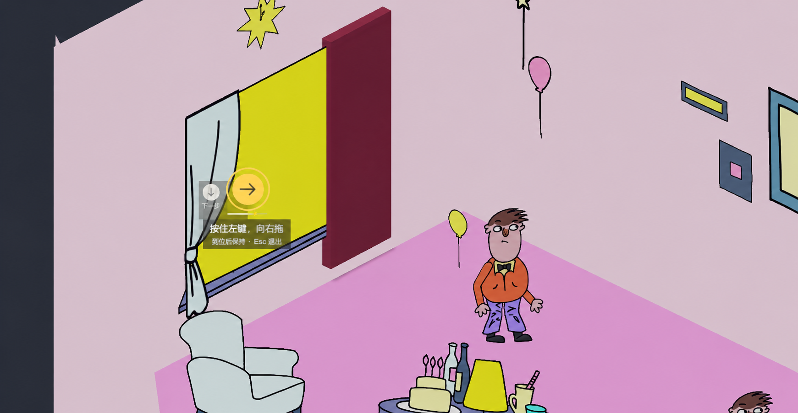

# 窗帘音游：小范围情境提示方案

日期：2026-11-06。

状态：**设计预览，尚未接入 Unity**。本图由 ImageGen 基于游戏截图制作，用于评审布局；它不是已实现功能的运行截图。现有 Xbox 输入、震动与 E/A 附身气泡已实现，与本方案分别记录。

## 布局方向

- 保持原版提示贴近窗帘的布局，让场景占据主要视野；不使用大面积底板或横贯屏幕的节拍轨道。
- 当前动作放在小圆盘中，外圈表达拍点临近；相邻的淡化小图标只预告下一步动作。
- 拖动距离使用圆盘下方的短星标进度，与节拍进度区分。
- 初次操作显示简短说明；重复动作可缩短文字。键鼠与手柄说明跟随最后一次有效操作切换。
- 到位后显示“到位，保持”；只有游戏实际判定成功，才短暂显示绿勾。

## 对接现有判定的约束

主要代码是 `Assets/Scripts/GhostPartyPrototype.cs`、`Assets/Scripts/CurtainGameplayUI.cs` 和 `Assets/LevelWhitebox/Runtime/LevelCurtainEncounter.cs`。

- 复用当前 DSP 节拍时钟、目标拍点、输入窗口与延迟补偿，不把预览谱面或 BPM 写成另一套数据源。
- 方向操作的距离完成不等于成功：必须在当前允许准备的时段取得有效方向/位移，并保持抓握等待实际成功判定。过早的输入不能被 UI 表现成已准备完成。
- 保持阶段用时间进度表达持续抓握，不能把它当成拖动距离。
- 漏拍重试、等待客人靠近等阶段，下一目标拍点尚未确定时只预告动作，不显示假定的倒计时。
- 自动收紧和其他自动演出不得仅因步骤切换就显示输入成功的绿勾。
- 黄色高亮若用于判定窗口，必须由当前动作的真实有效时段驱动；装饰性的接近圈不能冒充可输入窗口。

后续实现应先以现有判定落地上述小范围提示，再用首次试玩验证准备时长、文字可读性与节拍反馈。

生成工具：ImageGen。最终生成提示词见 [prompt.txt](prompt.txt)。
