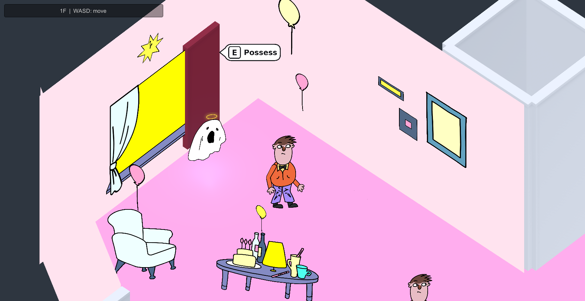
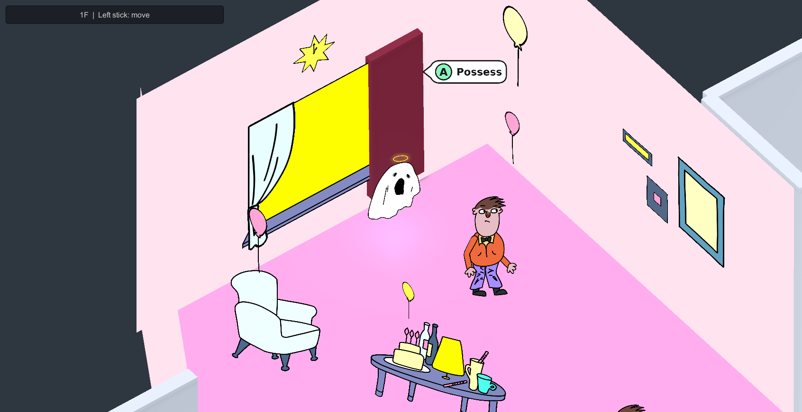

# Xbox 输入与附身提示验证记录

日期：2026-11-06。环境：Unity 2022.3.62f2c1，Input System 1.7.0，Active Input Handling 为 Both。

这份记录归档此前完成的 Unity 验证。上传阶段没有重跑 Play 测试；上传前比对了两轮交付记录的 30 个文件 SHA-256，全部一致。

| 检查 | 通过 | 失败 | 原始结果 |
| --- | ---: | ---: | --- |
| E/A 附身气泡专项 | 35 | 0 | [possess-ui-checks.json](possess-ui-checks.json) |
| 一楼与 SampleScene 手柄/键鼠完整流程 | 203 | 0 | [play-checks.json](play-checks.json) |

此前 Unity 原生编译通过。完整流程检查覆盖移动、附身 A 释放门控、点按、RT 方向与保持、连续左右换向、B 退出、三档震动命令及清理、键鼠操作和原有 UI 回调。

测试使用虚拟输入设备，震动命令通过拦截验证；不能等同于实体 Xbox 人工通关或马达体感确认。实体手柄操作、真实断连后的马达表现和音画手感仍需人工验收，具体步骤见 [手柄输入与震动](../../手柄输入与震动.md) 与 [附身提示 UI](../../附身提示UI.md)。

以下两张为该轮测试捕获的实际 Game 画面，与新节拍 UI 的设计预览区分。

